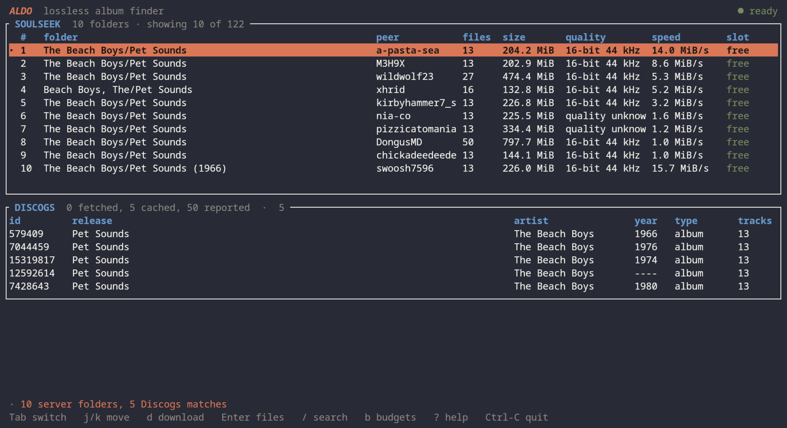

# Aldo

[](https://github.com/hwngtr/aldo/actions/workflows/ci.yml)

Aldo finds lossless albums on SoulSeek, downloads the files, and writes the
metadata from Discogs. One binary, one person, one machine, nothing running in
the background.

## The idea, in one table

Two sources answer two unrelated questions, and Aldo needs both answers.

| | The question | The answer |
|---|---|---|
| **Discogs** | What *is* this record? | The release, its year, its tracklist, its album artist |
| **SoulSeek** | Who has the *files* right now? | Peers, folders, bit depths, speeds |

Discogs is a catalogue: stable, complete, and impossible to download from.
SoulSeek is a network: it has the bytes and no idea what they are. Neither is
enough on its own, so Aldo asks both at once and puts the answers side by side.



Read the top pane as a shortlist, not a catalogue. 122 folders matched and the
ten Aldo ranked highest for that query are shown; every one of them is offering a
free upload slot, because a folder whose peer is not serving cannot be downloaded
from. The `quality` column repeats what the peer claimed and nothing more — two
of these folders claim nothing, which is why it says `quality unknown` rather
than guessing at 16-bit.

The bottom pane is the other half. Those are five pressings of the same 1966
record, which is why **the number you download by and the Discogs id are
different numbers**. The highlighted `#1` in the top pane and `579409` in the
bottom one are answers to different questions.

## Setup

**Install.** On Arch, from the project directory:

```sh
cd packaging && makepkg -si
```

Anywhere else, from source:

```sh
cargo build --release --locked -p aldo
install -Dm755 target/release/aldo ~/.local/bin/aldo
```

`target/` is a build cache and can be large. Once the binary is installed it is
safe to discard: `cargo clean`. Debug info and incremental artifacts are already
off (see `[profile.dev]` and `[profile.test]` in `Cargo.toml`), so a build leaves
far less behind than the defaults.

Tagging needs `metaflac`, which ships with flac: `sudo pacman -S flac`.

**Credentials.** The first time `aldo` opens the interface it asks for a
SoulSeek account and, optionally, a Discogs personal access token, then saves
them to `~/.config/aldo/.env` at mode 0600 inside a 0700 directory. Every later
run signs in from that file. A Discogs token comes from
<https://www.discogs.com/settings/developers> and is optional: without one,
searches still run but downloads are not tagged.

SoulSeek has no signup step — logging in with an unused name creates the
account. In a terminal, `aldo login` asks the same questions:

```sh
aldo login
```

For a script or a pipe, pass the values as flags instead
(`--username`, `--password`, `--token`); a missing required value is
refused rather than prompted for. Giving any flag makes it a partial update, so
a token can be added later without retyping the account:

```sh
aldo login --token TOKEN
```

`aldo logout` forgets the saved credentials, and the next run asks again. A
variable exported in your shell overrides the file and is not touched by
`logout`, so unset it too if you set one. `aldo whoami` prints the username a
run would use, whether it came from the environment or the file, and the path of
the file — without printing any secret. Music goes to `~/Music`, which Aldo
creates when it is the default and missing. `.env.example` lists every variable
there is, for anyone who would rather write the file by hand.

## Use

```sh
aldo                                        # the interface
aldo tui -q "The Beach Boys - Pet Sounds"   # straight to the results
aldo search "The Beach Boys - Pet Sounds"   # the same search, to stdout
aldo download 3                             # the folder numbered 3
```

`aldo` with a terminal attached opens the interface; with no terminal — a pipe or
a script — it prints its help, which is what a script expects.

| Command | Does |
|---|---|
| `aldo` | The interface, or the help when there is no terminal |
| `aldo tui [-q QUERY]` | The interface, optionally searching immediately |
| `aldo login [--username U] [--password P] [--token T]` | Prompt for and save credentials; any one flag is a partial update |
| `aldo logout` | Forget the saved credentials |
| `aldo whoami` | Show which credentials a run would use, and where they come from. Secrets are never printed |
| `aldo search "QUERY" [--limit N]` | Search and print. `--limit` caps how many Discogs release bodies are fetched |
| `aldo download N [--list] [--force] [--discogs-release ID]` | Download daily index N |
| `aldo budgets` | What is left of each provider's rate allowance |
| `aldo sessions` | Recent searches, newest first |

Queries are read structurally in either order — `Artist - Album`,
`Album - Artist`, or either with a trailing year. A dashed query is searched both
ways and the duplicate Discogs releases are merged. A bare phrase like
`besame mucho` still works, but it can match an unrelated record, so Aldo may
refuse to download a folder that does not match the release it picked.

## Keys

| Key | Does |
|---|---|
| `/` | Search |
| `Tab` | Server folders ⇄ Discogs matches |
| `j` `k`, `↑` `↓` | Move the selection |
| `Enter`, `l` | List the files in a folder |
| `d` | Download, after a confirmation |
| `t` | Tag with the highlighted pressing |
| `b`, `s`, `?` | Budgets, sessions, help |
| `Esc`, `h` | Back |
| `Ctrl-C` | Quit |
| `Ctrl-A` / `Ctrl-E` | In the prompt: select the whole query / jump to its end |

Typing while a selection is up replaces it; `Backspace` or `Delete` clears it.
`Home` and `End` move the caret, and any of those drops the selection. `docs/TUI.md`
covers the screens and the reasoning.

## Where things land, and what gets written

`aldo download 3` takes the **daily index** from that day's search and writes to
`~/Music/<artist>/<album>/`. Indexes reset at UTC midnight, and each new search
replaces the previous day's list.

| Flag | Does |
|---|---|
| `--list` | Print the folder's files and stop |
| `--force` | Download without Discogs matching or tags, for an extended, incomplete or otherwise unmatched folder |
| `--discogs-release ID` | Tag with a specific pressing instead of the first match |

A normal download refuses when the folder's file count disagrees with the
release's track count, because tagging a partial folder writes wrong metadata.
Track numbers are read from filenames, so a file containing `- 01 -` gets the
Discogs title for track 1. The tags written are title, album, artist, album
artist, track number, track total, disc number, year, and the Discogs release id
— via `metaflac`, which rewrites the metadata blocks and never the audio frames.

`--slsk-share` and `--library-root` override the shared folder and the library
for one run. Both are honoured from the environment as well.

## When a search comes back empty

SoulSeek has no index. Results come only from peers who are online in the seconds
the search runs, so an empty answer is not proof the album is not there — the
same query a minute later can answer differently. Give peers longer:

```sh
aldo --slsk-timeout 20 search "Prince - Purple Rain"
```

Aldo is at pains to keep four different failures looking different: not
configured, rate limited, connected but nobody answered, and everything filtered
out as lossless-unrelated. `docs/TROUBLESHOOTING.md` explains what each one means
and what to do about it.

## Things that will surprise you

- **Discogs allows 60 requests a minute, and Aldo caches every release body
  forever.** The second identical search costs one request and no more.
- **SoulSeek allows 34 searches per 220 seconds.** Exceeding it is a 30-minute ban
  whose only symptom is searches that return nothing, which is why `aldo budgets`
  exists and why the interface shows it as bars.
- **Sharing nothing gets you queued last.** Aldo shares `~/Music` by default;
  `--slsk-share` changes it, and forwarding port 2234 helps too.
- **The optional HTTP API** is off by default. It exists so a shell could drive
  the same libraries, binds loopback only, and needs `--features api`.

## Contributing

`docs/PLAN.md` holds the phase plan and the decisions that are not obvious from
the code. `docs/SYSTEM_DESIGN.md` has the architecture, `docs/DATA_MODEL.md` the
schema, and `docs/TUI.md` the interface. CI runs `cargo fmt --check`, clippy with
warnings denied, and the test suite, inside a ten-minute wall-clock budget.

## Updating

```sh
cargo build --release --locked -p aldo
cd packaging && makepkg -si
```

## Licence

MIT. See [`LICENSE`](LICENSE).
